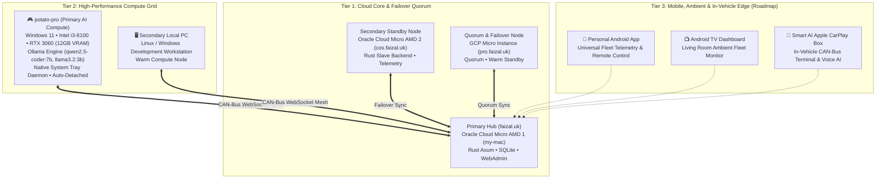

# 🌌 Nexus Fleet System — Master Architecture, Handover & Roadmap

> **Author**: Md Faizal & Antigravity Pair-Programming Agent  
> **Repository**: [Md-Faizal/Portfolio-Website](https://github.com/Md-Faizal/Portfolio-Website)  
> **Date**: November 5, 2026  
> **Status**: Production Deployed (`master` branch, commit `093d6b5`+)  
> **Central Hub**: `https://faizal.uk` / `wss://faizal.uk/api/mesh/ws`  

---

## 1. Executive Summary & Context

This document captures the **complete architectural state, foundational charter, diagnostic history, technical implementations, database schemas, and forward-looking roadmap** of the **Nexus Fleet & Distributed AI Ecosystem**.

As the conversational context reached its capacity limit, this master document serves as the **single source of truth** to seamlessly bootstrap subsequent development conversations without loss of context, architectural intent, or operational knowledge.

---

### 1.1. The Cockroach Philosophy ("Cockrock" Autonomous Resilience Charter)

From the project's inception, the core engineering principle for the Nexus Fleet has been **"The Cockroach Doctrine"**:
> *"Build an ultra-lightweight, self-reliant, always-alive Stark network that can adapt itself, scale itself, and survive a metaphorical nuclear fallout — zero crashes, zero external dependencies, self-healing, self-starting, and invisible in the background."*

Key pillars of this survival doctrine:
1. **Zero-Token, Zero-Friction Bootstrap:** Any new node in the fleet connects via a single terminal one-liner (`curl -fsSL https://faizal.uk/install.sh | bash` on Linux/macOS or `irm https://faizal.uk/install.ps1 | iex` on Windows) without requiring manual token generation, API key configuration, or interactive prompts.
2. **Crash-Proof Rust Binary:** Built entirely in native Rust with LTO (Link-Time Optimization) and stripped down to ~2 MB. Consumes <15 MB of RAM and zero measurable CPU during idle telemetry streaming.
3. **Self-Healing & In-Place Self-Updating:** The binary updates itself in-place via `nexus update`, automatically handles Windows UAC elevation, terminates and restarts its background daemons to avoid file locks, keeps backups, and rolls back instantly if a downloaded binary fails validation.
4. **Persistent Daemon Survivability:** Operates as a true background daemon that survives terminal closures, shell exit, SSH disconnects, and system reboots.
5. **Unified Multi-Node Identity:** Whether running under systemd root or a normal interactive terminal user, all local processes share the exact same configuration and stable node ID.

---

### 1.2. The Automotive CAN-Bus Multiplexing Mesh Architecture

The fleet's networking is modeled directly after **modern automotive Controller Area Network (CAN bus)** multiplexing:
* In a high-performance vehicle, the CAN bus links Engine Control Units (ECUs), transmission, braking, infotainment, and telemetry sensors across a single shared, high-reliability message bus.
* In the Nexus Fleet, the **Rust backend (`personal-site-rust`) acts as the central CAN-Bus Controller**, maintaining persistent bidirectional WebSocket connections (`wss://faizal.uk/api/mesh/ws`) to all fleet nodes.
* Every connected device (cloud servers, desktop gaming rigs, mobile phones, in-car CarPlay adapters) acts as an independent ECU broadcasting structured CAN frames (`NodeHello`, `TelemetryReport`, `ServiceControl`, `AiStream`, `LiveTelemetryPill`).
* Telemetry streams at regular cadence (15s idle, 2s active), while high-priority commands (1-click service restarts, model weight evictions, terminal chats) interrupt and dispatch with sub-millisecond latency.

---

### 1.3. Comprehensive Fleet Hardware & Node Topology

The Nexus Fleet spans three distinct operational tiers:



#### Detailed Node Specifications:
1. **Cloud Core (3 Instances):**
   * **`my-mac` (Oracle Cloud Micro AMD, `ssh my-mac` / `faizal.uk`):** Primary production hub. Hosts the active Rust Axum web backend, unified SQLite database, Docker container swarm, and the React 19 Admin Console.
   * **`cos` (Oracle Cloud Micro AMD, `ssh cos` / `cos.faizal.uk`):** Secondary Oracle instance. Runs the Rust backend in hibernating standby mode; continuously streams telemetry and monitors primary health. Wakes up automatically for load balancing or automated disaster failover.
   * **`pro` (Google Cloud Platform Micro, `ssh pro` / `pro.faizal.uk`):** Tertiary GCP instance. Maintains quorum and warm failover readiness across cloud providers.
2. **Local Compute Grid (2 Workstations):**
   * **`potato-pro` (`windows-potato-pro-0d64a4ab`):** The heavy compute engine of the fleet. Equipped with an **NVIDIA GeForce RTX 3060 (12 GB VRAM)** and Intel Core i3-8100 CPU. Runs local Ollama with `qwen2.5-coder:7b` and `llama3.2:3b`. Remotely orchestratable via the Nexus AI Studio for prompt streaming, model pre-loading (`nexus load`), and VRAM purging (`nexus unload`). Runs a native Windows Taskbar tray daemon with the official **`F•`** logo.
   * **Secondary Local PC:** Secondary desktop workstation for development, load distribution, and fallback compute.
3. **Mobile, Ambient & In-Vehicle Expansion Fleet (Roadmap):**
   * **Personal Android App:** Currently existing custom app to be refactored and debloated into a universal, ultra-fast fleet control app for node inspection and 1-click restarts.
   * **Android TV:** Ambient living-room dashboard displaying 24/7 cluster status, container states, and system health.
   * **Smart AI Apple CarPlay Box:** In-dash automotive CAN-bus terminal that connects the car's head unit to the Nexus Fleet, displaying system metrics and enabling voice/text interaction with local AI models running on `potato-pro`.

---

## 2. Core Problems Diagnosed & Permanent Solutions

During real-world deployment across Windows, macOS, and Linux (Zorin OS), several subtle OS-level and architectural issues were identified and resolved:

### 2.1. Linux False "Telemetry ON" & Service Disconnection
* **Symptom 1**: Running `nexus status` falsely reported `Daemon State: ● RUNNING` while the central admin panel showed the node as offline.
  * **Root Cause**: `daemon_lock::is_daemon_running()` previously used a loose substring check matching any running process containing `"nexus"`. Because the command itself was named `nexus`, it matched its own PID and concluded the daemon was running!
  * **Fix**: Rewrote `is_daemon_running()` in `nexus-agent/src/modules/daemon_lock.rs` to verify that `"run"` is present in the command-line arguments, and on Linux directly query `systemctl is-active --quiet nexus-agent.service`.
* **Symptom 2**: Running `nexus run` directly in bash brought the node online, but closing the terminal disconnected the agent immediately.
  * **Root Cause**: SIGHUP terminated interactive foreground processes.
  * **Fix**: Added native daemonization and background systemd service management.
* **Symptom 3**: `nexus service install --user` failed to start automatically on system reboot.
  * **Root Cause**: The unit file previously set `WantedBy=multi-user.target`. For systemd user units (`systemd --user`), `multi-user.target` is invalid and causes silent failure; user units must target `default.target`.
  * **Fix**: In `nexus-agent/src/service/systemd.rs`, user mode sets `WantedBy=default.target` (root uses `multi-user.target`), injects explicit `Environment="HOME=..."` and standard `PATH`, and activates with `systemctl enable --now nexus-agent`.
  * **Headless Persistence**: In `public/install.sh`, `loginctl enable-linger "$USER"` is run automatically during user install so user services persist after logout without requiring a graphical session.

---

### 2.2. Windows Taskbar Notification Tray Icon Blank / Generic
* **Symptom**: On Windows 11, the tray tooltip showed `Nexus Fleet Agent — Online (...)`, but the icon showed Windows' generic default window icon (`IDI_APPLICATION`) instead of the branded logo.
* **Root Cause**: `LoadIconW(h_instance, 1 as *const u16)` failed on high-DPI taskbars expecting 16x16 / 24x24 / 32x32 icon sizes.
* **Fix**: In `nexus-agent/src/modules/tray.rs`, icon extraction now calls `ExtractIconExW` directly against the running binary path (`GetModuleFileNameW(null_mut(), ...)`), extracting the exact embedded icon resource, with fallback to `LoadImageW` scaled to `SM_CXSMICON`/`SM_CYSMICON`.

---

### 2.3. Windows Auto-Updater "Access is Denied" (OS Error 5)
* **Symptom**: Running `nexus update --force` in PowerShell threw:  
  `Error: Os { code: 5, kind: PermissionDenied, message: "Access is denied." }`.
* **Root Causes**:
  1. **Protected Directory**: When installed in `C:\Program Files\NexusAgent\nexus.exe`, a standard non-elevated PowerShell process cannot write or rename files in `Program Files`.
  2. **Active Executable File Lock**: The background daemon (`nexus-agent.exe run`) was running in the background, locking its binary handle and preventing sibling alias copies (`nx.exe`, `nexus-agent.exe`).
* **Fix in `nexus-agent/src/updater/mod.rs`**:
  1. **Directory Write Check**: `is_directory_writable()` verifies access beforehand. If write access is denied on Windows, it automatically prompts for UAC elevation via `powershell Start-Process '<exe>' -ArgumentList 'update --force' -Verb RunAs`.
  2. **Daemon Termination & Graceful Swap**: Terminates running background daemon instances (excluding current PID) using `taskkill /F /FI "PID ne <current_pid>" /IM nexus-agent.exe /IM nexus.exe`, waits 300ms for handle release, performs atomic swap, and restarts the background worker automatically post-update.

---

### 2.4. Automatic Version Incrementing in CI/CD
* **Symptom**: `nexus update` reported `Nexus Fleet Agent is already up to date (version 0.1.0)` because versions were static.
* **Fix in `.github/workflows/deploy.yml`**:
  * In `build-backend` and `build-agent-windows`, the CI/CD pipeline dynamically sets:  
    `VERSION="0.1.${{ github.run_number }}"` in `nexus-agent/Cargo.toml`.
  * In `deploy-cluster`, `public/releases/latest.json` is updated with the matching `version` and `release_date`.
  * Every GitHub push automatically produces monotonically increasing versions (e.g. `0.1.25` → `0.1.26`), allowing remote agents to detect updates reliably.

---

### 2.5. Terminal Closure Disconnection Fix (Windows & Linux Auto-Detachment)
* **Symptom**: When running `nexus run` in PowerShell on Windows or bash on Linux, closing the terminal window immediately disconnected the agent and killed the tray daemon.
* **Root Causes**:
  * On Windows, child processes spawned in a terminal inherit the console session. When the console window closes, Windows broadcasts `CTRL_CLOSE_EVENT` and terminates the entire process tree. Additionally, `hide_console_window()` was hiding the user's interactive PowerShell window.
  * On Linux, foreground interactive processes receive `SIGHUP` when the shell exits.
* **Fix in `nexus-agent/src/main.rs` & `nexus-agent/src/service/windows.rs`**:
  * `nexus run` now defaults to **auto-detachment**:
    * **Windows**: Spawns detached worker with `DETACHED_PROCESS | CREATE_NEW_PROCESS_GROUP | CREATE_NO_WINDOW`, immediately returning control to the user's terminal with a confirmation message. The detached worker has no console window and is completely immune to terminal closures.
    * **Linux / macOS**: Checks for and starts the native systemd unit (`systemctl --user start nexus-agent`), or detaches with null stdio and a new session ID (`setsid`).
  * `nexus run --foreground` (or `-f`) is provided if an operator explicitly wants to run in the foreground for debugging.

---

### 2.6. Dedicated Fast CLI Release Action (`fast-cli-release.yml`)
* **Objective**: Avoid waiting 5–8 minutes for full cluster deployments (rebuilding frontend, backend, docker compose) when only updating the agent CLI executable.
* **Implementation**:
  * Created `.github/workflows/fast-cli-release.yml`.
  * Triggers exclusively on pushes to `nexus-agent/**`, `public/releases/**`, or 1-click `workflow_dispatch`.
  * Compiles Linux (`ubuntu-latest`) and Windows (`windows-latest`) binaries concurrently using cached crates.
  * Automatically updates `latest.json` with the new version and rsyncs `public/releases/` straight to the server (`faizal.uk`).
  * Deploys CLI updates in **under 1.5 minutes with zero downtime**.
  * Configured `paths-ignore: ['nexus-agent/**']` in `deploy.yml` so full cluster deploys are reserved for backend/frontend changes.

---

### 2.7. Windows PowerShell Visual Breakdown (Virtual Terminal Processing)
* **Symptom**: In standard Windows PowerShell (conhost.exe), running `nexus update` or `nexus status` showed raw escape characters like `←[1;36m` instead of colors.
* **Root Cause**: Windows Console Host does not enable `ENABLE_VIRTUAL_TERMINAL_PROCESSING` (0x0004) by default for console applications. Standard ASCII 27 (ESC) was printed as a left arrow (`←`).
* **Fix**: In `nexus-agent/src/main.rs`, added `enable_virtual_terminal_processing()` at application launch using `windows_sys::Win32::System::Console::SetConsoleMode`, turning on full 24-bit/ANSI color rendering across PowerShell and cmd.

---

### 2.8. Auto-Updater Download Timeout & Real-Time Streaming Chunks
* **Symptom**: Running `nexus update --force` failed with `Error: reqwest::Error { kind: Decode, source: reqwest::Error { kind: Body, source: TimedOut } }`.
* **Root Cause**: `reqwest::Client` had a hard 10-second total request/response timeout for the entire 2.5 MB binary download. On slower connections or modest latency, downloading 2.5 MB took slightly longer than 10 seconds, triggering an immediate timeout.
* **Fix**: In `nexus-agent/src/updater/mod.rs`, increased total timeout to 180 seconds with 15s connect timeout. Replaced `dl_res.bytes().await` with a real-time chunk streaming loop using `futures_util::StreamExt`, displaying dynamic download progress (`⚡ Progress: 1.45/2.17 MB (66.8%)`).

---

### 2.9. Windows Tray & Executable Icon Re-Encoding (JFIF/JPEG to Compliant ICO)
* **Symptom**: Taskbar notification tray showed Windows' generic white window dialog icon instead of the branded logo.
* **Root Cause**: `resources/app.ico` was a JFIF/JPEG image wrapped in an `.ico` header. Windows GDI strictly forbids JPEG payloads in ICO files, silently falling back to `IDI_APPLICATION`.
* **Fix**: Re-encoded `app.ico` into a 100% compliant multi-resolution ICO (16, 24, 32, 48, 64, 256px) of Faizal's **`F•`** logo. Added in-memory fallback in `tray.rs` via `CreateIconFromResourceEx` and fixed the relative path in `build.rs` to avoid spaces in `MacOS Project`.

---

### 2.10. Multi-User Linux Shared Node Identity
* **Symptom**: Installing as root via `sudo` caused the admin panel to show a different node from `nexus status` run by a normal user.
* **Root Cause**: Running under sudo created `/etc/nexus-agent/config.json`, while normal users looked in `~/.config/nexus-agent/config.json`, generating two separate node IDs.
* **Fix**: `AgentConfig::config_path()` now prioritizes `/etc/nexus-agent/config.json` with permissions `0666` so all users and background services share the exact same node ID. If saving fails due to permissions, the agent gracefully falls back to saving in `~/.config/nexus-agent/config.json` without failing.

---

### 2.11. Linux Non-Root Daemonization & Resilient Path Resolution
* **Symptom**: On Linux machines without an active systemd user DBus session (e.g. headless SSH logins or desktop environments like Zorin OS), running `nexus run` or `install.sh` failed to start the agent, and `nexus` was not found in PATH on new shells.
* **Fixes**:
  * **Verified Service Activation**: `handle_run_command` now checks whether `systemctl --user is-active --quiet nexus-agent` actually succeeded. If DBus is unavailable or systemctl fails, it automatically falls back to launching an independent detached background process with `setsid` and `SIGHUP` ignored.
  * **Deterministic Lock Detection**: Rewrote `daemon_lock::is_daemon_running()` on Linux to test `libc::flock(LOCK_EX | LOCK_NB)` against active lock files (`/run`, `/var/run`, `/run/user/<uid>`, and `/tmp`). This eliminates false negatives caused by restricted `/proc/[pid]/cmdline` visibility.
  * **PATH Auto-Configuration**: `install.sh` now appends `export PATH="$HOME/.local/bin:$PATH"` to `~/.bashrc`, `~/.zshrc`, and `~/.profile` if missing, ensuring `nexus` and `nx` are recognized across all terminal sessions.

---

### 2.12. macOS Full Native Support (Launchd & Universal Binary)
* **Status Before**: macOS lacked native launchd lifecycle controls (`start`, `stop`, `restart`, `status`), GPU telemetry was spawning heavy `system_profiler` processes on every poll, and no macOS binaries were built in CI/CD.
* **Fixes**:
  * **Launchd Service Management**: Implemented full `LaunchdInstaller` (`start`, `stop`, `restart`, `status`, `install`, `uninstall`). Configured `run --foreground` in the launchd plist (`uk.faizal.nexus-agent.plist`) to prevent launchd respawn loops.
  * **Cached Apple Silicon Telemetry**: Cached GPU identification (`SPDisplaysDataType`) in a static `OnceLock`, eliminating repeated `system_profiler` executions and keeping idle CPU usage at ~0%.
  * **macOS OS Control Commands**: Implemented macOS-native handlers for remote commands via WebSocket mesh:
    * `reboot` → `shutdown -r +1`
    * `shutdown` → `shutdown -h +1`
    * `sleep` → `pmset sleepnow`
    * `restart_service` → `launchctl kickstart -k <service>`
  * **Universal Binary CI/CD**: Added `build-macos-agent` on `macos-latest` to `.github/workflows/deploy.yml` and `.github/workflows/fast-cli-release.yml`. Compiles both Apple Silicon (`aarch64-apple-darwin`) and Intel (`x86_64-apple-darwin`), merges them into a universal binary via `lipo`, and publishes `nexus-agent-darwin-arm64` and `nexus-agent-darwin-amd64` to `https://faizal.uk/releases/`.

---

## 3. Reconstructed Features & Architecture

### 3.1. Dual-Mode Fleet Operator Console (`nexus chat`)
The terminal interface (`nexus chat`) and the Web Admin Console have been unified into a dual-mode system:

```
╭─ SELECT CONSOLE MODE ────────────────────────────────────────────────────────╮
│  [1] 💬 Fleet Chat (Global Broadcast & Device-to-Device Messaging)          │
│  [2] 🤖 Distributed Nexus AI Studio (Fleet Compute Engine) [Default]         │
│  [3] 🖥️ Standalone Local Terminal AI (Offline / Local Ollama)               │
╰──────────────────────────────────────────────────────────────────────────────╯
```

#### Mode 1: Fleet Chat (IRC / WhatsApp Style Messaging)
* **Channels**:
  * `#global`: Broadcasts to all connected nodes and web consoles.
  * `@device:<node_id>` or `@<hostname>`: Direct peer-to-peer messaging.
* **Storage**: Messages persist in the central SQLite `fleet_chat_messages` table and broadcast instantly over WebSockets.
* **CLI Commands**:
  * `/join <#chan|@node>`: Switch channel
  * `/channels`: List online nodes
  * `/refresh`: Pull latest messages
  * `/mode ai`: Jump to Distributed AI Studio

#### Mode 2: Distributed Nexus AI Studio
* **Multi-Node Compute**: Operators can target any node in the cluster (`windows-potato-pro`, `my-mac`, `zorin-box`) to run prompts through that node's GPU or local Ollama engine.
* **Edge Case Handling for Devices with No Models** (e.g. `my-mac`):
  * Node displays with `models: (none installed)`.
  * If selected, displays notice:  
    `⚠️ NOTICE: Node 'my-mac' has NO AI models installed!`
  * Offers 1-click `/pull <model>` command (CLI) or **"Pull Lightweight Model (1.5B)"** button (Web Admin) dispatching a remote download via `POST /api/fleet/nodes/:id/pull`.
* **Resource Safety Guard (OOM Prevention)**:
  * Calculates free RAM and VRAM. If a node has **< 2.0 GB free memory** or **> 85% RAM load**, displays high-visibility warning:  
    `⚠️ RESOURCE SAFETY ALERT: Target has only 1.2 GB free RAM (85% used)! Loading large models (7B+) may trigger OOM kill.`
* **Offline Node Safeguard**:
  * Nodes not connected to the mesh display last known models and last seen timestamp.
  * Prompts to offline nodes are intercepted to prevent connection timeout errors.
* **Persistent Conversation History**:
  * Stored in SQLite (`fleet_ai_conversations` and `fleet_ai_messages`).
  * CLI: `/history` lists past sessions, `/resume <id>` loads transcripts, and `/clear` starts a fresh conversation.
  * Web Admin: Conversation drawer with real-time SSE token streaming and delete actions.

---

## 4. SQLite Database Schema Reference

The database on `faizal.uk` (`backend-rust/data/state.db`) holds the persistent tables:

```sql
-- 1. Fleet Chat Messages (Global Broadcast & Device DMs)
CREATE TABLE IF NOT EXISTS fleet_chat_messages (
    id INTEGER PRIMARY KEY AUTOINCREMENT,
    chat_id TEXT NOT NULL,               -- 'global' or 'device:<node_id>'
    sender_id TEXT NOT NULL,             -- Node ID or 'operator'
    sender_name TEXT NOT NULL,           -- Display hostname or operator name
    recipient_id TEXT,                   -- Target node ID for private DMs
    content TEXT NOT NULL,               -- Message text
    message_type TEXT DEFAULT 'text',    -- 'text', 'alert', 'command'
    created_at DATETIME DEFAULT CURRENT_TIMESTAMP
);
CREATE INDEX IF NOT EXISTS idx_fleet_chat_id ON fleet_chat_messages (chat_id, id);

-- 2. Fleet AI Conversations
CREATE TABLE IF NOT EXISTS fleet_ai_conversations (
    id TEXT PRIMARY KEY,                 -- UUID
    title TEXT NOT NULL,                 -- Prompt snippet or operator title
    target_node_id TEXT NOT NULL,        -- Compute node running the model
    model TEXT NOT NULL,                 -- e.g. 'qwen2.5-coder:7b'
    system_prompt TEXT,                  -- Persona instructions
    temperature REAL DEFAULT 0.7,
    created_at DATETIME DEFAULT CURRENT_TIMESTAMP,
    updated_at DATETIME DEFAULT CURRENT_TIMESTAMP
);

-- 3. Fleet AI Messages (Conversation Transcripts)
CREATE TABLE IF NOT EXISTS fleet_ai_messages (
    id INTEGER PRIMARY KEY AUTOINCREMENT,
    conversation_id TEXT NOT NULL,
    role TEXT NOT NULL,                  -- 'user', 'assistant', 'system'
    content TEXT NOT NULL,
    node_id TEXT,                        -- Node that generated the response
    created_at DATETIME DEFAULT CURRENT_TIMESTAMP,
    FOREIGN KEY(conversation_id) REFERENCES fleet_ai_conversations(id) ON DELETE CASCADE
);
CREATE INDEX IF NOT EXISTS idx_fleet_ai_messages ON fleet_ai_messages (conversation_id, id);

-- 4. Persistent Node Registry & Offline Cache
CREATE TABLE IF NOT EXISTS fleet_nodes_history (
    node_id TEXT PRIMARY KEY,
    hostname TEXT NOT NULL,
    os TEXT NOT NULL,
    os_version TEXT,
    arch TEXT,
    agent_version TEXT,
    status TEXT DEFAULT 'offline',       -- 'online' or 'offline'
    last_seen DATETIME DEFAULT CURRENT_TIMESTAMP,
    last_telemetry TEXT,                 -- JSON payload (CPU, RAM, GPU, VRAM)
    last_models TEXT                     -- JSON array of installed models
);
```

---

## 5. API Endpoints Specification

All routes are mounted under the authenticated Axum router on `https://faizal.uk`:

| Method | Endpoint | Description |
|---|---|---|
| `GET` | `/api/fleet/nodes` | List all fleet nodes (merges live WS state + historical SQLite nodes) |
| `POST` | `/api/fleet/nodes/:id/load` | Pre-warm model weights into target node's VRAM |
| `POST` | `/api/fleet/nodes/:id/unload` | Evict model weights from target node's VRAM (`keep_alive: 0`) |
| `POST` | `/api/fleet/nodes/:id/pull` | Dispatch remote `ollama pull` on target node |
| `GET` | `/api/fleet/chat/messages` | Fetch messages (`?chat_id=global&limit=50`) |
| `POST` | `/api/fleet/chat/messages` | Send chat message and broadcast over WebSocket mesh |
| `GET` | `/api/fleet/ai/conversations` | List persistent AI conversations with message counts |
| `POST` | `/api/fleet/ai/conversations` | Create a new AI conversation session |
| `GET` | `/api/fleet/ai/conversations/:id/messages` | Fetch full transcript of a conversation |
| `POST` | `/api/fleet/ai/conversations/:id/messages` | Stream prompt response via SSE and save user & assistant messages |
| `DELETE` | `/api/fleet/ai/conversations/:id` | Delete conversation and associated messages |

---

## 6. CLI Command Cheatsheet

```bash
# Agent lifecycle
nexus run                 # Start background telemetry daemon and taskbar tray
nexus status              # Display live identity, CPU/RAM/VRAM, and daemon state
nexus elevate             # Upgrade to Administrator / Root background service

# Cluster Operations & Services (Requires 4-Digit Admin PIN, default: '2004')
nexus --pin 2004 cluster            # Live health and latency across 3-VM cluster
nexus --pin 2004 services           # Inspect running Docker containers, web engines, games
nexus --pin 2004 restart <service>  # 1-Click restart a cluster service
nexus --pin 2004 health             # 24-hour cluster health and uptime report
# Or set environment variable once:
#   Windows PowerShell: $env:NEXUS_ADMIN_PIN="2004"
#   Linux / macOS Bash: export NEXUS_ADMIN_PIN="2004"

# Operator Console & Nexus Chat (Retro ASCII Gradient: 'NEXUS CHAT')
nexus chat                # Interactive menu: [1] Nexus Chat, [2] Distributed AI Studio
nexus chat -c chat        # Direct launch into Nexus Chat (#global & device DMs)
nexus chat -c ai          # Direct launch into Distributed AI Studio
nexus chat -m qwen2.5-coder:7b  # Direct launch with model override
# Inside Nexus Chat:
#   /pin <PIN>            # Authenticate or update cluster PIN dynamically (e.g. /pin 2004)
#   /join <channel>       # Switch active channel (#global, @node-id)
#   /channels             # List all online workstations & edge nodes

# Local & Remote Model Management
nexus ps                  # Inspect models currently resident in VRAM / RAM
nexus load <model> [dur]  # Pre-warm model in VRAM (default: 15m)
nexus unload <model>      # Evict model from VRAM immediately

# Self-Update
nexus update              # Check and auto-upgrade agent binary
nexus update --force      # Force re-download and re-install latest release
```

---

## 7. Cluster Security, Authentication & Admin PIN

### 7.1 Where does the Admin PIN come from?
1. **Default Value**: The cluster-wide default admin PIN is **`2004`**.
2. **Server-Side Definition**: Defined in the Rust backend (`backend-rust/src/config.rs`) as:
   ```rust
   admin_pin: std::env::var("ADMIN_PIN").unwrap_or_else(|_| "2004".into())
   ```
   and synchronized with the legacy Node backend (`backend/server.js`).
3. **Database Override**: The central SQLite database (`cluster_hub.db` / `messages.db`) stores custom PIN overrides under:
   ```sql
   SELECT value FROM settings WHERE key = 'admin_pin' AND length(value) = 4
   ```
   Admins can change this PIN anytime from the Web Admin Settings or via `POST /api/change-pin`.
4. **Client Agent Authentication**:
   When invoking commands requiring elevated cluster rights (`cluster`, `services`, `restart`, and sending messages via `nexus chat`), the agent supplies the PIN through HTTP headers:
   * `Authorization: Bearer <PIN>`
   * `x-admin-pin: <PIN>`
5. **Zero-Configuration Fallback**:
   `nexus-agent` defaults missing PIN credentials to `"2004"` and persists it to `config.json` (`config.token`), preventing unauthorized `403 Forbidden` errors during interactive chat and cluster exploration. Operators can supply custom PINs via `--pin <PIN>`, `$env:NEXUS_ADMIN_PIN`, or the in-chat `/pin <PIN>` command.

---

## 7. Strategic Goals & Roadmap for Next Conversation

When starting the new conversation, the following objectives represent the immediate priorities:

1. **Android Fleet Client (Flutter or Native Kotlin)**:
   * Consume `/api/fleet/chat/messages` and `/api/fleet/ai/conversations`.
   * Real-time push notifications for `#global` announcements and direct node mentions.
   * Remote model execution and service restart right from the mobile app.
2. **Headless VM & Zorin OS Memory Tuning**:
   * Create dedicated memory-conservation profiles for headless Linux boxes (e.g. disable GPU poller when no discrete GPU is found, tune poll intervals).
   * Ollama CPU-only threading optimization (`OLLAMA_NUM_PARALLEL`, `OLLAMA_FLASH_ATTENTION`).
3. **Automated Health Self-Healing**:
   * Allow the central hub to automatically dispatch `/restart` or alerts when a node or container crashes or experiences sustained memory saturation (>95%).
4. **Enhanced Chat Media & Code Connect**:
   * Allow sending system diagnostic logs, screenshots, and diff files through Fleet Chat.

