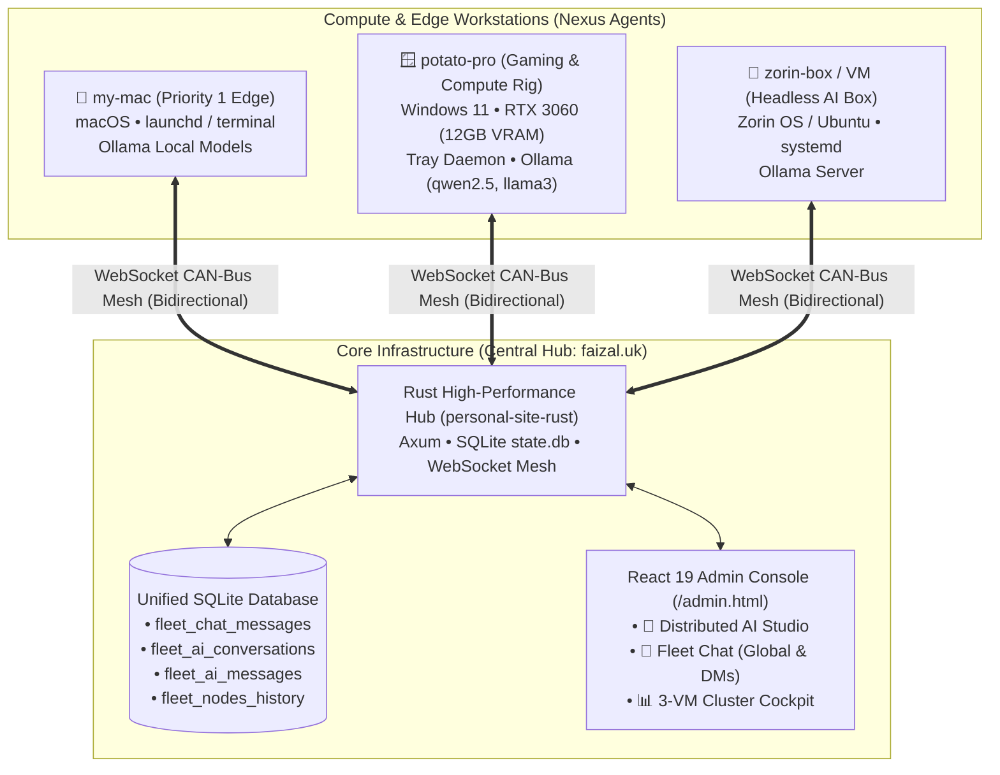

# 🌌 Nexus Fleet System — Master Architecture, Handover & Roadmap

> **Author**: Md Faizal & Antigravity Pair-Programming Agent  
> **Repository**: [Md-Faizal/Portfolio-Website](https://github.com/Md-Faizal/Portfolio-Website)  
> **Date**: November 5, 2026  
> **Status**: Production Deployed (`master` branch, commit `093d6b5`+)  
> **Central Hub**: `https://faizal.uk` / `wss://faizal.uk/api/mesh/ws`  

---

## 1. Executive Summary & Context

This document captures the **complete architectural state, diagnostic history, technical implementations, database schemas, and forward-looking roadmap** of the **Nexus Fleet & Distributed AI Ecosystem**.

As the conversational context reached its capacity limit, this master document serves as the **single source of truth** to seamlessly bootstrap subsequent development conversations without loss of context, architectural intent, or operational knowledge.



---

## 2. Core Problems Diagnosed & Permanent Solutions

During real-world deployment across Windows, macOS, and Linux (Zorin OS), several subtle OS-level and architectural issues were identified and resolved:

### 2.1. Linux False "Telemetry ON" & Service Disconnection
* **Symptom 1**: Running `nexus status` falsely reported `Daemon State: ● RUNNING` while the central admin panel showed the node as offline.
  * **Root Cause**: `daemon_lock::is_daemon_running()` previously used a loose substring check matching any running process containing `"nexus"`. Because the command itself was named `nexus`, it matched its own PID and concluded the daemon was running!
  * **Fix**: Rewrote `is_daemon_running()` in `nexus-agent/src/modules/daemon_lock.rs` to verify that `"run"` is present in the command-line arguments, and on Linux directly query `systemctl is-active --quiet nexus-agent.service`.
* **Symptom 2**: Running `nexus run` directly in bash brought the node online, but closing the terminal disconnected the agent immediately.
  * **Root Cause**: SIGHUP terminated interactive foreground processes.
  * **Fix**: Added native daemonization and background systemd service management.
* **Symptom 3**: `nexus service install --user` failed to start automatically on system reboot.
  * **Root Cause**: The unit file previously set `WantedBy=multi-user.target`. For systemd user units (`systemd --user`), `multi-user.target` is invalid and causes silent failure; user units must target `default.target`.
  * **Fix**: In `nexus-agent/src/service/systemd.rs`, user mode sets `WantedBy=default.target` (root uses `multi-user.target`), injects explicit `Environment="HOME=..."` and standard `PATH`, and activates with `systemctl enable --now nexus-agent`.
  * **Headless Persistence**: In `public/install.sh`, `loginctl enable-linger "$USER"` is run automatically during user install so user services persist after logout without requiring a graphical session.

---

### 2.2. Windows Taskbar Notification Tray Icon Blank / Generic
* **Symptom**: On Windows 11, the tray tooltip showed `Nexus Fleet Agent — Online (...)`, but the icon showed Windows' generic default window icon (`IDI_APPLICATION`) instead of the branded logo.
* **Root Cause**: `LoadIconW(h_instance, 1 as *const u16)` failed on high-DPI taskbars expecting 16x16 / 24x24 / 32x32 icon sizes.
* **Fix**: In `nexus-agent/src/modules/tray.rs`, icon extraction now calls `ExtractIconExW` directly against the running binary path (`GetModuleFileNameW(null_mut(), ...)`), extracting the exact embedded icon resource, with fallback to `LoadImageW` scaled to `SM_CXSMICON`/`SM_CYSMICON`.

---

### 2.3. Windows Auto-Updater "Access is Denied" (OS Error 5)
* **Symptom**: Running `nexus update --force` in PowerShell threw:  
  `Error: Os { code: 5, kind: PermissionDenied, message: "Access is denied." }`.
* **Root Causes**:
  1. **Protected Directory**: When installed in `C:\Program Files\NexusAgent\nexus.exe`, a standard non-elevated PowerShell process cannot write or rename files in `Program Files`.
  2. **Active Executable File Lock**: The background daemon (`nexus-agent.exe run`) was running in the background, locking its binary handle and preventing sibling alias copies (`nx.exe`, `nexus-agent.exe`).
* **Fix in `nexus-agent/src/updater/mod.rs`**:
  1. **Directory Write Check**: `is_directory_writable()` verifies access beforehand. If write access is denied on Windows, it automatically prompts for UAC elevation via `powershell Start-Process '<exe>' -ArgumentList 'update --force' -Verb RunAs`.
  2. **Daemon Termination & Graceful Swap**: Terminates running background daemon instances (excluding current PID) using `taskkill /F /FI "PID ne <current_pid>" /IM nexus-agent.exe /IM nexus.exe`, waits 300ms for handle release, performs atomic swap, and restarts the background worker automatically post-update.

---

### 2.4. Automatic Version Incrementing in CI/CD
* **Symptom**: `nexus update` reported `Nexus Fleet Agent is already up to date (version 0.1.0)` because versions were static.
* **Fix in `.github/workflows/deploy.yml`**:
  * In `build-backend` and `build-agent-windows`, the CI/CD pipeline dynamically sets:  
    `VERSION="0.1.${{ github.run_number }}"` in `nexus-agent/Cargo.toml`.
  * In `deploy-cluster`, `public/releases/latest.json` is updated with the matching `version` and `release_date`.
  * Every GitHub push automatically produces monotonically increasing versions (e.g. `0.1.25` → `0.1.26`), allowing remote agents to detect updates reliably.

---

## 3. Reconstructed Features & Architecture

### 3.1. Dual-Mode Fleet Operator Console (`nexus chat`)
The terminal interface (`nexus chat`) and the Web Admin Console have been unified into a dual-mode system:

```
╭─ SELECT CONSOLE MODE ────────────────────────────────────────────────────────╮
│  [1] 💬 Fleet Chat (Global Broadcast & Device-to-Device Messaging)          │
│  [2] 🤖 Distributed Nexus AI Studio (Fleet Compute Engine) [Default]         │
│  [3] 🖥️ Standalone Local Terminal AI (Offline / Local Ollama)               │
╰──────────────────────────────────────────────────────────────────────────────╯
```

#### Mode 1: Fleet Chat (IRC / WhatsApp Style Messaging)
* **Channels**:
  * `#global`: Broadcasts to all connected nodes and web consoles.
  * `@device:<node_id>` or `@<hostname>`: Direct peer-to-peer messaging.
* **Storage**: Messages persist in the central SQLite `fleet_chat_messages` table and broadcast instantly over WebSockets.
* **CLI Commands**:
  * `/join <#chan|@node>`: Switch channel
  * `/channels`: List online nodes
  * `/refresh`: Pull latest messages
  * `/mode ai`: Jump to Distributed AI Studio

#### Mode 2: Distributed Nexus AI Studio
* **Multi-Node Compute**: Operators can target any node in the cluster (`windows-potato-pro`, `my-mac`, `zorin-box`) to run prompts through that node's GPU or local Ollama engine.
* **Edge Case Handling for Devices with No Models** (e.g. `my-mac`):
  * Node displays with `models: (none installed)`.
  * If selected, displays notice:  
    `⚠️ NOTICE: Node 'my-mac' has NO AI models installed!`
  * Offers 1-click `/pull <model>` command (CLI) or **"Pull Lightweight Model (1.5B)"** button (Web Admin) dispatching a remote download via `POST /api/fleet/nodes/:id/pull`.
* **Resource Safety Guard (OOM Prevention)**:
  * Calculates free RAM and VRAM. If a node has **< 2.0 GB free memory** or **> 85% RAM load**, displays high-visibility warning:  
    `⚠️ RESOURCE SAFETY ALERT: Target has only 1.2 GB free RAM (85% used)! Loading large models (7B+) may trigger OOM kill.`
* **Offline Node Safeguard**:
  * Nodes not connected to the mesh display last known models and last seen timestamp.
  * Prompts to offline nodes are intercepted to prevent connection timeout errors.
* **Persistent Conversation History**:
  * Stored in SQLite (`fleet_ai_conversations` and `fleet_ai_messages`).
  * CLI: `/history` lists past sessions, `/resume <id>` loads transcripts, and `/clear` starts a fresh conversation.
  * Web Admin: Conversation drawer with real-time SSE token streaming and delete actions.

---

## 4. SQLite Database Schema Reference

The database on `faizal.uk` (`backend-rust/data/state.db`) holds the persistent tables:

```sql
-- 1. Fleet Chat Messages (Global Broadcast & Device DMs)
CREATE TABLE IF NOT EXISTS fleet_chat_messages (
    id INTEGER PRIMARY KEY AUTOINCREMENT,
    chat_id TEXT NOT NULL,               -- 'global' or 'device:<node_id>'
    sender_id TEXT NOT NULL,             -- Node ID or 'operator'
    sender_name TEXT NOT NULL,           -- Display hostname or operator name
    recipient_id TEXT,                   -- Target node ID for private DMs
    content TEXT NOT NULL,               -- Message text
    message_type TEXT DEFAULT 'text',    -- 'text', 'alert', 'command'
    created_at DATETIME DEFAULT CURRENT_TIMESTAMP
);
CREATE INDEX IF NOT EXISTS idx_fleet_chat_id ON fleet_chat_messages (chat_id, id);

-- 2. Fleet AI Conversations
CREATE TABLE IF NOT EXISTS fleet_ai_conversations (
    id TEXT PRIMARY KEY,                 -- UUID
    title TEXT NOT NULL,                 -- Prompt snippet or operator title
    target_node_id TEXT NOT NULL,        -- Compute node running the model
    model TEXT NOT NULL,                 -- e.g. 'qwen2.5-coder:7b'
    system_prompt TEXT,                  -- Persona instructions
    temperature REAL DEFAULT 0.7,
    created_at DATETIME DEFAULT CURRENT_TIMESTAMP,
    updated_at DATETIME DEFAULT CURRENT_TIMESTAMP
);

-- 3. Fleet AI Messages (Conversation Transcripts)
CREATE TABLE IF NOT EXISTS fleet_ai_messages (
    id INTEGER PRIMARY KEY AUTOINCREMENT,
    conversation_id TEXT NOT NULL,
    role TEXT NOT NULL,                  -- 'user', 'assistant', 'system'
    content TEXT NOT NULL,
    node_id TEXT,                        -- Node that generated the response
    created_at DATETIME DEFAULT CURRENT_TIMESTAMP,
    FOREIGN KEY(conversation_id) REFERENCES fleet_ai_conversations(id) ON DELETE CASCADE
);
CREATE INDEX IF NOT EXISTS idx_fleet_ai_messages ON fleet_ai_messages (conversation_id, id);

-- 4. Persistent Node Registry & Offline Cache
CREATE TABLE IF NOT EXISTS fleet_nodes_history (
    node_id TEXT PRIMARY KEY,
    hostname TEXT NOT NULL,
    os TEXT NOT NULL,
    os_version TEXT,
    arch TEXT,
    agent_version TEXT,
    status TEXT DEFAULT 'offline',       -- 'online' or 'offline'
    last_seen DATETIME DEFAULT CURRENT_TIMESTAMP,
    last_telemetry TEXT,                 -- JSON payload (CPU, RAM, GPU, VRAM)
    last_models TEXT                     -- JSON array of installed models
);
```

---

## 5. API Endpoints Specification

All routes are mounted under the authenticated Axum router on `https://faizal.uk`:

| Method | Endpoint | Description |
|---|---|---|
| `GET` | `/api/fleet/nodes` | List all fleet nodes (merges live WS state + historical SQLite nodes) |
| `POST` | `/api/fleet/nodes/:id/load` | Pre-warm model weights into target node's VRAM |
| `POST` | `/api/fleet/nodes/:id/unload` | Evict model weights from target node's VRAM (`keep_alive: 0`) |
| `POST` | `/api/fleet/nodes/:id/pull` | Dispatch remote `ollama pull` on target node |
| `GET` | `/api/fleet/chat/messages` | Fetch messages (`?chat_id=global&limit=50`) |
| `POST` | `/api/fleet/chat/messages` | Send chat message and broadcast over WebSocket mesh |
| `GET` | `/api/fleet/ai/conversations` | List persistent AI conversations with message counts |
| `POST` | `/api/fleet/ai/conversations` | Create a new AI conversation session |
| `GET` | `/api/fleet/ai/conversations/:id/messages` | Fetch full transcript of a conversation |
| `POST` | `/api/fleet/ai/conversations/:id/messages` | Stream prompt response via SSE and save user & assistant messages |
| `DELETE` | `/api/fleet/ai/conversations/:id` | Delete conversation and associated messages |

---

## 6. CLI Command Cheatsheet

```bash
# Agent lifecycle
nexus run                 # Start background telemetry daemon and taskbar tray
nexus status              # Display live identity, CPU/RAM/VRAM, and daemon state
nexus elevate             # Upgrade to Administrator / Root background service

# Cluster Operations (3-VM Swarm: my-mac, cos, pro)
nexus cluster             # Live health and latency across the 3 nodes
nexus services            # Inspect running Docker containers, web engines, and games
nexus restart <service>   # 1-Click restart a cluster service (e.g. personal-site-rust)

# Operator Console & AI Studio
nexus chat                # Interactive menu: [1] Fleet Chat, [2] Distributed AI Studio
nexus chat -c chat        # Direct launch into Fleet Chat (#global & device DMs)
nexus chat -c ai          # Direct launch into Distributed AI Studio
nexus chat -m qwen2.5-coder:7b  # Direct launch with model override

# Local & Remote Model Management
nexus ps                  # Inspect models currently resident in VRAM / RAM
nexus load <model> [dur]  # Pre-warm model in VRAM (default: 15m)
nexus unload <model>      # Evict model from VRAM immediately

# Self-Update
nexus update              # Check and auto-upgrade agent binary
nexus update --force      # Force re-download and re-install latest release
```

---

## 7. Strategic Goals & Roadmap for Next Conversation

When starting the new conversation, the following objectives represent the immediate priorities:

1. **Android Fleet Client (Flutter or Native Kotlin)**:
   * Consume `/api/fleet/chat/messages` and `/api/fleet/ai/conversations`.
   * Real-time push notifications for `#global` announcements and direct node mentions.
   * Remote model execution and service restart right from the mobile app.
2. **Headless VM & Zorin OS Memory Tuning**:
   * Create dedicated memory-conservation profiles for headless Linux boxes (e.g. disable GPU poller when no discrete GPU is found, tune poll intervals).
   * Ollama CPU-only threading optimization (`OLLAMA_NUM_PARALLEL`, `OLLAMA_FLASH_ATTENTION`).
3. **Automated Health Self-Healing**:
   * Allow the central hub to automatically dispatch `/restart` or alerts when a node or container crashes or experiences sustained memory saturation (>95%).
4. **Enhanced Chat Media & Code Connect**:
   * Allow sending system diagnostic logs, screenshots, and diff files through Fleet Chat.
