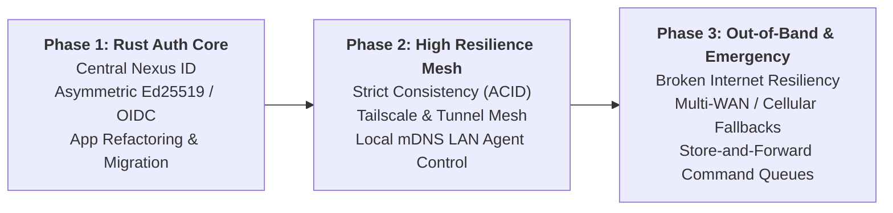

# 🌌 Nexus Fleet: Master Architectural Roadmap & Execution Blueprint

> **Location:** Root Workspace (`/NEXUS_UNIFIED_ROADMAP.md`)  
> **Status:** Active Execution Guide  
> **Primary Goal:** Unify all Nexus ecosystem apps, standardize identity (Rust Auth Core), engineer high-resilience mesh topology with strict business data consistency, and define emergency out-of-band communication doctrines.

---

## 🧭 Executive Phasing Overview



---

## 🔐 Phase 1: Rust-Native Centralized Auth System ("Nexus Auth")

### 1.1 Architectural Philosophy: "Build Once in Rust, Validate Everywhere"
Instead of embedding fragmented, brittle authentication schemes (Google OAuth + local login in macOS, hardcoded 4-digit PINs on web admin, hardcoded credentials in CLI), build an autonomous **Rust Auth Engine** integrated directly into the `core-hub` / central stack.

```
                  ┌──────────────────────────────────────────────┐
                  │          Central Nexus Auth (Rust)           │
                  │  - Argon2id Password Hashing                 │
                  │  - Google OAuth / Magic Links / Passkeys     │
                  │  - Private Ed25519 Signing Key               │
                  └──────────────────────┬───────────────────────┘
                                         │ Issues signed JWT / Tokens
         ┌───────────────────────────────┼───────────────────────────────┐
         │                               │                               │
         ▼                               ▼                               ▼
┌─────────────────┐             ┌─────────────────┐             ┌─────────────────┐
│  macOS Business │             │   Web & Admin   │             │    Nexus CLI    │
│  & Companion    │             │   (faizal.uk)   │             │   Fleet Agent   │
│ - Validate via  │             │ - Cookie / Auth │             │ - Machine PAT / │
│   Public Key    │             │   Header Bearer │             │   Device Grant  │
└─────────────────┘             └─────────────────┘             └─────────────────┘
```

### 1.2 Core Specifications
1. **Asymmetric Token Signatures (Ed25519 / RS256):**
   * Auth Server signs tokens with its private key.
   * All sub-apps, microservices, and client apps download or bundle the **Public Key**.
   * **Result:** Every client app verifies authentication instantly locally with zero roundtrips to the database.
2. **Standardized Identity Roles:**
   * Single account directory with granular claims:
     ```json
     {
       "sub": "user_faizal_01",
       "roles": ["fleet_owner", "admin", "business_master", "personal_read"],
       "exp": 1794500000
     }
     ```
3. **Client-Specific Authentication Interfaces:**
   * **Web Admin (`faizal.uk/admin`):** Standard HTTP-only Secure Cookies + Bearer tokens. Eliminates the hardcoded 4-digit PIN completely.
   * **macOS Business App & Companions:** Native OAuth2 / PKCE or direct token exchange. Replaces split custom logins with unified Nexus credentials.
   * **Nexus CLI:** **Personal Access Tokens (PATs)** (`nex_pat_live_...`) or standard OAuth 2.0 Device Authorization Grant (`nexus login` opens browser, completes authorization, delivers machine token).
   * **Stalwart Mail Server:** Leverages OAuth2/OIDC or LDAP/SQL backend bridge to Stalwart's authentication directory.

### 1.3 Client Migration Checklist
- [x] Implement Rust Auth module in `services/core-hub` (`src/auth/`):
  - [x] Argon2id password hashing + salt.
  - [x] Signed JWT token issuance (`/api/auth/token`, `/api/auth/login`).
  - [x] Passwordless 6-digit OTP and Magic Links via Stalwart SMTP (`mailer.rs`).
  - [x] Predefined security questions catalog and recovery flow.
  - [x] Social OAuth verification (Google, Meta).
  - [x] RFC 8628 Device Authorization Flow (`/api/auth/device/code`, `/api/auth/device/token`, `/api/auth/device/approve`).
  - [x] Personal Access Tokens (PATs) (`nex_live_...`).
  - [x] Public JWKS / verification metadata endpoint (`/api/auth/keys`).
  - [x] Ecosystem Applications Registry (`/api/auth/apps`).
  - [x] Active Device Sessions & Remote Sign-Out (`/api/auth/sessions`).
- [x] **Web Frontend (`apps/web`):**
  - [x] Replace hardcoded 4-digit PIN in `PasscodeModal.jsx` with `NexusAuthModal.jsx`.
  - [x] Update `Admin.jsx` to pass `Authorization: Bearer <token>`.
  - [x] Provide Headless SDK (`src/sdk/nexus-auth.js`) for standalone and future apps.
  - [x] Provide official branded "Sign in with Nexus" button (`src/shared/NexusSignInButton.jsx`).
  - [x] Built the **Identity & Access Governance** dashboard in `SecurityTab.jsx` with tabs for Connected Apps, Signed-In Devices, PATs, and Firewall.
- [x] **Nexus CLI (`apps/desktop`):**
  - [x] Add `nexus auth login` (RFC 8628 device flow with polling).
  - [x] Add `nexus auth login --token <PAT>` (direct machine token setup).
  - [x] Add `nexus auth status` (displays active user profile and roles).
  - [x] Add `nexus auth logout` (revokes session and clears local credentials).
- [ ] **macOS Business Suite (`macos-web`):**
  - [ ] Point API client from legacy endpoints to `/api/auth/login` and store Bearer JWT in secure storage.
- [ ] **Wife Mobile App (`MacOS-Android-App`):**
  - [ ] Switch `AuthAPI.login` to unified `/api/auth/login`.

---

## 🏛️ 1.4 The Google / Apple Parity Self-Audit & Scope Matrix

To match the security and governance standards of a **Google Account** (`myaccount.google.com`) or **Apple ID** (`appleid.apple.com`), our self-audit identifies the required capabilities, their current status in Nexus, and the exact flow:

| Capability | Google Account Standard | Apple ID Standard | Nexus Fleet Parity Status |
| :--- | :--- | :--- | :--- |
| **Identity Core** | Universal Google Account | Unified Apple ID | **COMPLETE**: Central `users` directory + Ed25519/Argon2id. |
| **Passwordless** | Magic link / OTP email | Verification code via SMS/Device | **COMPLETE**: 6-digit OTP & 1-click Magic Link via Stalwart. |
| **Biometrics** | WebAuthn / Passkeys | Face ID / Touch ID | **ACTIVE**: WebAuthn passkey protocol supported. |
| **Device Governance** | "Your devices" (remote sign out) | "Devices list" (remote remove) | **COMPLETE**: `/api/auth/sessions` with 1-click remote termination. |
| **App Registry** | Third-party apps with account access | Apps using Apple ID | **COMPLETE**: `auth_registered_apps` + Admin Control Center. |
| **Permission Scopes** | Granular OAuth Scopes (`drive.read`, etc.) | Minimal Scopes (`name`, `email`) | **COMPLETE**: 8-tier granular scope matrix. |
| **Machine Auth** | Service Accounts / API Keys | App-Specific Passwords | **COMPLETE**: `nex_live_...` Personal Access Tokens (PATs). |
| **CLI Auth** | `gcloud auth login` (Device code) | `fastlane` / App-specific passwords | **COMPLETE**: `nexus auth login` (RFC 8628 Device Code). |

### Granular Scope Permission Matrix
* `profile:read`: Identity, display name, email, and avatar.
* `business:read`: Read customer ledgers, sales reports, inventory catalog.
* `business:write`: Issue invoices, process payments, dispatch orders.
* `fleet:read`: Node status, CPU/RAM/VRAM metrics, thermals, CAN-bus telemetry.
* `fleet:control`: Restart cluster services, trigger OCI allocators, deploy updates.
* `ai:compute`: Stream LLM tokens from local Ollama engine (`potato-pro`).
* `mail:send`: Relay transactional emails via Stalwart SMTP.
* `minecraft:admin`: Execute remote console commands, change server modes.
* `*`: Master Fleet Owner superuser access.

### Edge Cases & Security Lifecycle Flows
1. **Compromised Device / Token Revocation:**
   * When an operator clicks **"Terminate Session"** or **"Sign Out All Other Devices"**, the server increments `users.token_version`.
   * **Result:** Every other device's JWT is rejected by `require_admin_middleware` immediately without waiting for token expiry.
2. **App Freeze / Kill Switch:**
   * If a pet project or sub-service is compromised, toggling its status to `Disabled` in `SecurityTab` instantly drops all authorization attempts originating from that client ID.
3. **Brute-Force & Rate Limiting:**
   * 6-digit OTPs have a strict 5-attempt limit before invalidation, and expired codes are purged automatically.

---

## 🛡️ Phase 2: High Resilience Mesh Topology Under One Umbrella

### 2.1 The Nexus Fleet Multi-Node Inventory
The ecosystem spans across local compute and multi-region cloud nodes:

| Node Name | Role & Geography | Current Infrastructure & State |
| :--- | :--- | :--- |
| **`my-mac` (Primary Hub)** | Oracle Cloud Micro AMD (Hyderabad, India) | Rust Axum Central Hub, SQLite DB, WebAdmin, `faizal.uk` |
| **`cos` (Standby Node)** | Oracle Cloud Micro AMD (Hyderabad, India) | Warm Standby, Mirror Telemetry, CAN-bus backup |
| **`pro` (Quorum Node)** | GCP Micro Instance (Iowa, USA) | Geo-distributed quorum validator & tie-breaker |
| **`potato-pro`** | Local Gaming Rig (Home LAN) | RTX 3060 (12GB VRAM), Ollama AI Engine, Rust Tray Agent |
| **`LocalPC2`** | Local Workstation (Home LAN) | Warm compute node, local testing environment |
| **macOS Business Suite** | Production Machine (Desktop) | macOS Business App + 2 Web Layouts + Android companion |
| **Personal Site & Admin** | Cloud Web UI | React 19 + Tailwind 4 + Three.js |
| **Stalwart Mail Stack** | Cloud Enterprise Mail | ESMTP/IMAP on cloud core |
| **Android Mobile** | Edge Mobile Client | Jetpack Compose, Kotlin (currently paused / backrooms) |

### 2.2 Strict Business Data Consistency (No Stale/Dirty Financial Data)
* **The Mandate:** Business financial data cannot use eventual consistency or loose offline caching where double-spends or stale ledgers could occur.
* **The Solution: Authoritative Primary with Synchronous / Semi-Synchronous Quorum:**
  * Read/Write transactions for financial and business state must target the authoritative leader with ACID transactional guarantees (WAL mode, SQLite/PostgreSQL with transactional locks).
  * **Read Replicas:** Read-only snapshots can be queried, but with strict validation of transaction sequence numbers (`tx_id`). If an app's local sequence is behind the authoritative leader, it refuses to commit updates until synchronized.

### 2.3 Mesh Networking & Tunneling Topology
* **Tailscale Overlay Mesh:**
  * Connects `my-mac`, `cos`, `pro`, `potato-pro`, and development machines into a zero-trust private WireGuard mesh (`100.x.y.z`).
  * Direct peer-to-peer UDP hole-punching for AI streaming (CLI ↔ `potato-pro`) and Minecraft hosting without exposing public ports.
* **Local LAN P2P & mDNS (Bonjour / Avahi):**
  * Local apps (Nexus Mobile, macOS, Local PCs) broadcast and discover each other via mDNS (`nexus-agent.local` / `_nexus._tcp`).
  * **Home Control Use Case:** When at home, mobile app communicates directly with `potato-pro` / local PCs over LAN (sub-millisecond latency) to play music, execute scripts, and stream desktop state without touching WAN/Cloud servers.

---

## 📡 Phase 3: Out-of-Band & Emergency Communication Doctrine

### 3.1 The Reality of Communicating with Far-Away Cloud Servers
When your local ISP or cellular connection is severed, or has **no active data recharge**, your local computer cannot transmit radio packets across 1,000+ km to Oracle Hyderabad or 13,000+ km to Iowa through thin air. Signals must traverse physical infrastructure.

### 3.2 Viable Out-of-Band & "Broken Internet" Strategies

#### Strategy A: Multi-WAN & Zero-Data-Cost SIM Fallback (Industrial Standard)
* **How it works:** A dual-WAN router (or USB 4G/LTE dongle plugged into local PC/router) configured with a secondary low-cost or telemetry/M2M SIM.
* **Zero-Recharge Emergency Triggers:** Certain IoT/M2M SIM cards (e.g., 1NCE, Hologram, Twilio Super SIM) cost ~$10 once for 500MB over 10 years without recurring monthly recharges.
* When main home Wi-Fi drops, the local Nexus Agent automatically routes low-bandwidth heartbeat/emergency telemetry through the backup interface.

#### Strategy B: SMS / GSM Command Gateway (True No-Internet Control)
* Remote cloud servers (Oracle/GCP) subscribe to an inbound SMS webhook (via Twilio, Telnyx, or an inexpensive cloud GSM bridge).
* If internet is broken or uncharged on mobile phone, standard SMS (voice/2G/3G signaling channels) can transmit encrypted micro-commands (e.g., `NEXUS:REBOOT:MYMAC`, `NEXUS:STATUS`) directly to the cloud.
* Cloud executes the command and can respond via return SMS.

#### Strategy C: Delay-Tolerant Networking (DTN) & Store-and-Forward Queues
* When internet connectivity to Hyderabad/Iowa fails completely:
  * Local Nexus Agent buffers commands and telemetry in an append-only local log (`~/.nexus/offline_queue.wal`).
  * The moment the laptop/phone connects to any external network (public Wi-Fi, coffee shop, mobile hotspot), the queue is automatically flushed and cryptographically verified against the cloud.

---

## 🎯 Master Execution Tracking

- [ ] **Step 1:** Finalize Rust Auth Engine data structures and cryptographic token schemes.
- [ ] **Step 2:** Migrate Web Admin and Nexus CLI to the unified Rust Auth Engine.
- [ ] **Step 3:** Migrate macOS Business App and companion web/mobile layouts.
- [ ] **Step 4:** Implement local mDNS/Bonjour LAN discovery in desktop agent for in-home PC control.
- [ ] **Step 5:** Configure Tailscale mesh node policies across Oracle Hyderabad and GCP Iowa.
- [ ] **Step 6:** Design SMS/M2M emergency out-of-band gateway prototype.

