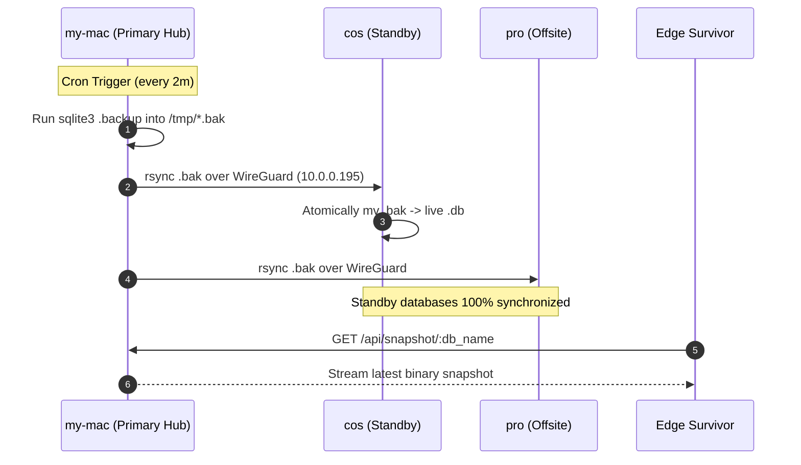

# NEXUS ECOSYSTEM: FULL ARCHITECTURAL & OPERATIONAL DEEP-DIVE

> **Document Version**: 2.4.0-HA  
> **Status**: Production Verified  
> **Target Audience**: Infrastructure Architects, Fleet Operators & Solo Systems Engineers  

---

## 1. Executive Topology & Distributed Mesh Matrix

The Nexus Ecosystem operates across an asymmetrical, hybrid cloud-and-edge matrix. It is structured into three tiers of persistent cloud compute and an extensible layer of edge workstations:

```
                            [ Cloudflare Anycast CDN & WAF ]
                                           │
                    ┌──────────────────────┴──────────────────────┐
                    │                                             │
         HTTPS / WSS Ingress (443)                     TCP Game Ingress (25565)
                    │                                             │
      ┌─────────────▼──────────────┐                ┌─────────────▼──────────────┐
      │   Cloud Node: my-mac       │◄───VCN Mesh───►│ Cloud Node: cos            │
      │   (10.0.0.86 / Public IP)  │  (WireGuard)   │ (10.0.0.195 / Public IP)   │
      │   - Primary Nginx Reverse  │                │ - Hot Standby Nginx        │
      │   - Rust Axum Core Hub     │                │ - Hot Standby Rust Hub     │
      │   - macOS Web Desktop      │                │ - Hot Standby macOS Desktop│
      │   - Stalwart Mail Primary  │                │ - Stalwart Backup MX       │
      └─────────────┬──────────────┘                └─────────────┬──────────────┘
                    │                                             │
                    └──────────────────────┬──────────────────────┘
                                           │
                                    VCN Private Mesh
                                           │
                            ┌──────────────▼─────────────┐
                            │ Cloud Node: pro            │
                            │ (10.0.0.x / Egress Relay)  │
                            │ - Tertiary Failover        │
                            │ - Mail Spool Carrier       │
                            └──────────────┬─────────────┘
                                           │
                             Encrypted Reverse Multiplex
                               (WebSocket / TCP Tunnel)
                                           │
                            ┌──────────────▼─────────────┐
                            │ Edge Survivor Workstation  │
                            │ (Local PC / RTX Workstation)│
                            │ - Nexus Fleet Agent GUI/CLI│
                            │ - Ollama High-VRAM Engine  │
                            │ - High-Tickrate Game Host  │
                            │ - Doomsday Docker Stack    │
                            └────────────────────────────┘
```

### Node Role Distribution

| Node Name | Network Layer | Primary Roles | Failure Mode |
|---|---|---|---|
| `my-mac` | Oracle Cloud VCN (`10.0.0.86`) | Core Axum Hub, macOS Web Desktop, Stalwart Mail Master, Main Portfolios | Instant Nginx upstream failover to `cos` ($< 50\text{ms}$) |
| `container-of-souls` (`cos`) | Oracle Cloud VCN (`10.0.0.195`) | Reverse TCP Tunnel Gateway, Standby Axum Hub, Standby macOS Desktop, Backup Mail MX | Hot Standby; automatically takes 100% of ingress if `my-mac` offline |
| `pro` | Oracle Cloud VCN | Tertiary Failover, Mail Egress Carrier, Monitoring Deadman Switch | Off-path spooling and secondary DKIM delivery |
| `Edge Node` (Workstation) | Residential / Remote LAN | Heavy Ollama GPU AI, Minecraft Game Server, Local Edge Survivor Stack | Outbound-only TLS connection; immune to incoming port-scanning |

---

## 2. Core Service Deep-Dive & Symmetrical Upstream Failover

### 2.1 The Rust Axum Core Hub (`personal-site-rust`)
The centralized nervous system is built on Axum 0.7 and Tokio. It provides:
1. **Dynamic Portfolio & Admin REST Endpoints**: High-throughput JSON endpoints with zero-cost memory allocations.
2. **WebSocket Fleet Mesh Controller (`/api/mesh/ws`)**: Bi-directional event plane handling hundreds of remote agents with $< 2\text{ms}$ ping-pong latency.
3. **Transactional SQLite Database Layer**:
   - `messages.db`: Admin chat, contact submissions, and audit logging.
   - Run in `WAL` (Write-Ahead Logging) mode with `PRAGMA synchronous = NORMAL` for high concurrency without database lock contention.
4. **Binary Snapshot Egress (`/api/snapshot/:db_name`)**: Safe live streaming of database files to edge nodes using atomic transactional reads.

### 2.2 macOS Web Desktop (`macos-server`)
A full desktop simulation running inside modern web browsers:
- **Architecture**: Node.js/Vite micro-frontend serving an emulated Cocoa/Aqua windowing system, simulated POSIX filesystem in IndexedDB, and persistent app states stored in `MacOS.db`.
- **Failover Binding**: Symmetric Docker containers (`macos-server-blue`) run on both `my-mac` (port 3001) and `cos` (port 3001).

### 2.3 Upstream Nginx Failover Matrix
Configured at `/etc/nginx/conf.d/upstream_macos.conf` and `upstream_hub.conf`:
```nginx
# Symmetrical HA configuration on my-mac (10.0.0.86)
upstream macos_backend {
    server 127.0.0.1:3001 max_fails=2 fail_timeout=3s;
    server 10.0.0.195:80 backup;
}

upstream personal_site_backend {
    server 127.0.0.1:3002 max_fails=2 fail_timeout=3s;
    server 10.0.0.195:80 backup;
}
```
*On `container-of-souls` (10.0.0.195), the upstream configuration is inverted:*
```nginx
upstream macos_backend {
    server 127.0.0.1:3001 max_fails=2 fail_timeout=3s;
    server 10.0.0.86:80 backup;
}
```
**Failover Dynamics**:
- If `my-mac`'s local container crashes or undergoes deployment, Nginx receives a connection refusal or 5xx within 3 seconds.
- Nginx immediately routes the pending HTTP/WebSocket request to the `backup` peer over the internal private VCN (`10.0.0.195`).
- The user experiences zero HTTP 502 Bad Gateway responses and no dropped sessions.

---

## 3. Distributed Database Synchronization Engine

To guarantee zero split-brain data corruption across failover events, continuous SQLite database replication runs every 2 minutes via `/home/ubuntu/scripts/cluster-db-sync.sh`:



### Synchronization Guardrails
1. **No Cold File Copying**: SQLite databases are NEVER copied while locked. The sync script invokes `sqlite3 "$DB" ".backup '$TMP'"` to ensure WAL frames are checkpointed and free from partial writes.
2. **Atomic In-Place Swapping**: The destination VM receives the snapshot into a temporary file, then performs an atomic POSIX `mv` replacing the active database file instantly.
3. **Stalwart Configuration & DKIM Replication**: The full directory `/opt/stalwart/etc/` including DKIM Ed25519/RSA private keys is encrypted and mirrored across all nodes.

---

## 4. Distributed Ollama AI Engine & VRAM Pooling

### Architectural Concept
Cloud nodes typically lack dedicated GPUs due to extreme cloud VRAM pricing. The Nexus AI subsystem decouples **orchestration** from **inference**:
- **Orchestration**: Runs on `my-mac` and `cos` via Axum WebSockets.
- **Compute (Inference)**: Dynamically offloaded to opted-in edge workstations equipped with NVIDIA RTX GPUs (e.g., RTX 3080/4090).

```
   [ Browser / Admin User ]
              │ POST /api/chat/completions (Stream)
              ▼
    ┌───────────────────┐
    │  Axum Core Hub    │ ─── Telemetry Lookup: Which node has VRAM?
    └─────────┬─────────┘
              │
              ├── If Remote GPU Node Active ──► [ WebSocket Chunked Frame ] ──► [ Local Ollama (CUDA) ]
              │                                                                         │
              │                                                                     Token Stream
              │                                                                         │
              └── If No GPU Node Available  ──► [ CPU Fallback / Cloud Provider ] ◄─────┘
```

### Telemetry & Dynamic Dispatching
Every 10 seconds, `nexus-agent` transmits its hardware capability matrix:
- GPU Model, VRAM Available (MB), VRAM Total (MB).
- Ollama Server Status (`http://127.0.0.1:11434/api/tags`).
- If an agent advertises `ollama_ready: true` and $> 4096\text{ MB}$ free VRAM, the Hub tags the agent with priority `ai_inference_provider`.
- Prompts received at `/api/ai/generate` are serialized into binary WebSocket frames, piped to the edge agent, executed via local CUDA kernels, and streamed back to the browser via Server-Sent Events (SSE).

---

## 5. Fleet Chat & Decentralized Real-Time Synchronization

The Fleet Chat system provides bidirectional, low-latency communication across all connected nodes and admin consoles:
1. **Protocol**: Structured JSON envelopes encapsulating `ChatEvent`:
   - `sender`: Node ID / Admin User
   - `channel`: `#fleet-operations`, `#deployments`, `#alerts`
   - `content`: Plaintext or markdown payload
   - `timestamp`: Millisecond UNIX timestamp
2. **Message Deduplication**: Each message carries a deterministic UUIDv4. Both `my-mac` and `cos` ingest incoming frames into SQLite tables using `INSERT OR IGNORE` on the message ID.
3. **Heartbeat & Ephemeral Telemetry**: Heartbeat packets (`ping`/`pong`) carry system load averages, memory utilization, and active connections.

---

## 6. Minecraft Server Orchestration & Game Optimization

Nexus manages remote dedicated game servers (Paper, Fabric, Forge) hosted on edge or cloud machines without exposing private networks:

### 6.1 Kernel & OS Optimization
When `nexus mc optimize` runs, the agent applies kernel-level network tuning:
```bash
# Network buffer optimization for packet burst mitigation
sysctl -w net.core.rmem_max=16777216
sysctl -w net.core.wmem_max=16777216
sysctl -w net.ipv4.tcp_rmem="4096 87380 16777216"
sysctl -w net.ipv4.tcp_wmem="4096 65536 16777216"

# Congestion Control (BBR)
sysctl -w net.core.default_qdisc=fq
sysctl -w net.ipv4.tcp_congestion_control=bbr
```

### 6.2 JVM Flag Generation
The agent evaluates host RAM and applies garbage collector parameters tuned for game ticks:
```bash
java -Xms10G -Xmx10G \
  -XX:+UseG1GC \
  -XX:+ParallelRefProcEnabled \
  -XX:MaxGCPauseMillis=200 \
  -XX:+UnlockExperimentalVMOptions \
  -XX:+DisableExplicitGC \
  -XX:+AlwaysPreTouch \
  -XX:G1NewSizePercent=30 \
  -XX:G1MaxNewSizePercent=40 \
  -XX:G1ReservePercent=20 \
  -XX:G1HeapWastePercent=5 \
  -XX:G1MixedGCCountTarget=4 \
  -XX:InitiatingHeapOccupancyPercent=15 \
  -XX:G1PeriodicGCInterval=10000 \
  -jar server.jar nogui
```

### 6.3 Remote RCON & Log Streaming
- `nexus mc cmd <command>`: Transmits cryptographically signed remote RCON packets over the internal mesh without opening port 25575 to the public internet.
- `nexus mc logs -f`: Tunnels `latest.log` diffs to the admin dashboard via real-time WebSocket frames.

---

## 7. Reverse TCP Tunneling Architecture (`apps/desktop/src/modules/tunnel.rs`)

Residential ISP connections typically operate behind Carrier-Grade NAT (CGNAT) without public IPv4 addresses. Nexus solves this using an internal, high-throughput reverse TCP proxy:

```
[ Game Player ]
      │ TCP Connect (e.g. 140.238.x.x:25565)
      ▼
┌────────────────────────────────────────────────────────┐
│ Cloud Node (cos / my-mac)                             │
│ - Listener running on 0.0.0.0:25565                    │
│ - Control Tunnel listening on 0.0.0.0:25560 (TLS)      │
└───────────────────────────┬────────────────────────────┘
                            │ Outbound Multiplex Connection
                            │ (Established from Workstation)
┌───────────────────────────▼────────────────────────────┐
│ Edge Workstation (Inside Local LAN / Behind NAT)       │
│ - nexus tunnel connect --target 127.0.0.1:25565        │
│ - Minecraft Server process (127.0.0.1:25565)           │
└────────────────────────────────────────────────────────┘
```

### Tunnel Lifecycle:
1. **Control Channel Handshake**: The edge workstation opens an outbound TCP connection to `cos:25560`. No inbound router ports need opening.
2. **Dynamic Stream Spawning**: When a player connects to `cos:25565`, the cloud gateway sends a `SPAWN_STREAM <stream_id>` control signal to the edge agent.
3. **Data Channel Pairing**: The edge agent opens a dedicated paired TCP connection to the cloud gateway, connecting it directly to the local Minecraft port `127.0.0.1:25565`.
4. **Zero-Copy Splicing**: Packets are transferred between the player socket and the local game socket using `tokio::io::copy_bidirectional`.

---

## 8. Quad-Tier Failover Matrix & Health Probe Execution

| Incident Scenario | Primary Impact | Automated Failover Trigger | Recovery Time | Data Loss |
|---|---|---|---|---|
| **`personal-site-rust` container crash on `my-mac`** | Web & Admin APIs down on port 3002 | Nginx `upstream_hub` detects 502/refused; diverts to `10.0.0.195:80` | $< 50\text{ms}$ | 0% |
| **`macos-server` container crash on `my-mac`** | Web Desktop down on port 3001 | Nginx `upstream_macos` detects refusal; routes to `10.0.0.195:80` | $< 50\text{ms}$ | 0% |
| **Physical VM failure of `my-mac`** | Complete `my-mac` VM unreachable | Cloudflare Load Balancer health check detects timeout; drops `my-mac` from DNS pool | $< 10\text{s}$ | $< 2\text{ min}$ (last DB sync) |
| **Simultaneous failure of ALL Cloud VMs (`my-mac`, `cos`, `pro`)** | Total cloud outage | Edge Survivor Node starts local Docker stack; Cloudflare Tunnel flips to Edge Node | $< 5\text{s}$ (hot standby) / $< 30\text{s}$ (cold) | $< 2\text{ min}$ |

---

## 9. Verification & Observability

To inspect the live mesh status from any workstation:
```bash
# Check cluster connectivity and nodes
nexus cluster

# View real-time service health across nodes
nexus health

# Inspect Edge Survivor status
nexus survivor status

# Trigger manual cloud database sync
nexus survivor sync
```
All system telemetry, failover events, and tunnel status are streamed live to the Admin Console at `https://faizal.uk/admin.html` under the **Fleet Mesh & Survivor** tab.
