# THE SOLO DEVELOPER PRODUCTION & SANITIZATION STANDARD
## Enterprise Architecture, Cloud/Remote Node Strategy & Zero-Downtime Lifecycle for 1-Person Engineering Teams

> **Author**: Antigravity Principal Systems Engineer  
> **Target Scope**: Cloud Infrastructure, Dev/Staging/Prod Sanitization, GPU/Game Offloading & Git Release Cycles  

---

## 1. The Solo Developer Dilemma & Architectural Philosophy

Building and operating multi-service production infrastructure as a solo developer presents unique challenges:
- **Zero Slack**: You are simultaneously DevOps, DBA, Backend, Frontend, and Security Engineer.
- **Resource Constraints**: Expensive managed cloud services (AWS EKS, RDS, NAT Gateways) drain budgets without adding core value.
- **Complexity Trap**: Heavy enterprise orchestration (Kubernetes, Consul, Vault) requires full-time maintenance.

### The Core Design Principle: The Tri-Tier Asymmetric Matrix
Never mix compute-heavy or state-volatile workloads (game servers, deep learning models, local code experiments) with latency-critical, high-reputation production services (mail servers, portfolio APIs, transactional databases).

```
               [ INGRESS & IDENTITY TIER ]
             Cloud VMs (Static IPs / Low RAM)
             - Edge Proxy (Nginx)
             - Mail Master & MX (Stalwart)
             - Hub Coordinator (Rust Axum)
                           │
       ┌───────────────────┴───────────────────┐
       ▼                                       ▼
[ PRODUCTION CLOUD CLUSTER ]          [ HEAVY COMPUTE EDGE ]
- Failover Standby (cos)              - Workstation / Home Server
- Offsite Relay (pro)                 - RTX GPU Inference (Ollama)
- Continuous DB Sync                  - Game Servers (Minecraft)
- Zero Public Port Forwarding         - Development & Testing Sandbox
                                      - Reverse TCP Tunnels Only
```

---

## 2. Infrastructure Topology: Cloud vs Remote Workstations

### 2.1 What Goes into the Cloud (Public & 24/7 Persistent)
Cloud VMs (e.g. Oracle Cloud Free Tier, Hetzner, DigitalOcean) should strictly host:
1. **Public Ingress & DNS Handlers**:
   - Nginx reverse proxies with Let's Encrypt / Cloudflare Origin certs.
2. **Mail Servers (SMTP/IMAP)**:
   - Stalwart Mail running on clean, reputable static IP addresses with valid rDNS (PTR), SPF, DKIM, and DMARC records.
3. **Low-Footprint REST & WebSocket APIs**:
   - Rust Axum or Go backends consuming $< 50\text{ MB}$ RAM.
4. **Coordination & Telemetry Hubs**:
   - Message brokers, health probes, and reverse tunnel ingress gateways.

### 2.2 What Stays on Remote Nodes / Local Workstations
Workstations (e.g., your local AMD Ryzen / Intel i9 machine with NVIDIA RTX GPU) should host:
1. **Local AI / LLM Inference**:
   - Ollama / vLLM utilizing 12GB–24GB of local VRAM (saving thousands of dollars annually in cloud GPU costs).
2. **Game Servers (Minecraft, Palworld, Valheim)**:
   - High-clock-speed CPU-bound tasks requiring 8GB–32GB RAM and intensive NVMe I/O.
   - Connected to the cloud via **Reverse TCP Tunnels**—never expose your residential IP address to players!
3. **Development & Staging Environments**:
   - Hot-reloading Vite dev servers, Docker compose sandboxes, local database copies.
4. **Edge Survivor Backup Hub**:
   - Ready to take over production in a doomsday cloud VM failure scenario.

---

## 3. Strict Dev, Staging & Prod Sanitization Cycle

A common catastrophic failure for solo developers is the "dev environment pollution" of production (e.g., testing a database migration directly on prod, or hardcoding dev credentials into release builds).

```mermaid
flowchart LR
    subgraph Workstation [Workstation Sandbox]
        DEV["Local Feature Dev<br/>(Git branch, Local SQLite)"]
        TEST["Pre-Flight Verify<br/>(cargo check, npm build)"]
    end

    subgraph CI [GitHub Actions Automation]
        LINT["Lint & Compile<br/>(Multi-platform Lipo)"]
        DRY["Dry-Run Tests"]
    end

    subgraph Cluster [Cloud Production Matrix]
        BLUE["Active Node (my-mac)<br/>Live Traffic"]
        GREEN["Standby Node (cos)<br/>Synced DB Replica"]
        SMOKE["Health Smoke Test<br/>(/api/maintenance-status)"]
    end

    DEV --> TEST
    TEST -->|Push to master| LINT
    LINT --> DRY
    DRY -->|Zero-Downtime Deploy| GREEN
    GREEN --> SMOKE
    SMOKE -->|Cutover / Reload| BLUE
```



### 3.1 The 4 Golden Rules of Sanitization
1. **Zero Secret Storage in Code**:
   - Never commit `.env` files or API keys.
   - Use GitHub Secrets for CI/CD compilation and deployment.
   - On servers, use root-only protected files (`chmod 600 /etc/nexus/env`).
2. **Isolated Database Files**:
   - Dev uses `/tmp/dev_test.db` or an in-memory SQLite database.
   - Prod uses WAL-mode `/app/data/messages.db`.
   - Never run manual `sqlite3` queries directly on live production databases; always test queries against a replicated backup copy first.
3. **Clean Port Allocation Table**:

| Environment | Service | Internal Port | External Binding |
|---|---|---|---|
| **Production** | macOS Desktop | `3001` | Cloud Nginx / Cloudflare |
| **Production** | Core Axum Hub | `3002` | Cloud Nginx / Cloudflare |
| **Production** | Stalwart Mail | `587`, `465`, `993` | Cloud Public IP |
| **Edge Compute** | Minecraft Game | `25565` | Reverse Tunnel -> `cos:25565` |
| **Edge Compute** | Ollama Engine | `11434` | Loopback only (`127.0.0.1`) |
| **Local Dev** | Vite Dev Server | `5173` | Localhost only |
| **Local Dev** | Rust Core Dev | `3003` | Localhost only |

4. **Resource Quotas (cgroups & Docker Limits)**:
   - Prevent a runaway Minecraft world-generation spike from starving your portfolio or email server.
   - In `docker-compose.yml`:
     ```yaml
     services:
       minecraft:
         image: itzg/minecraft-server
         deploy:
           resources:
             limits:
               cpus: '3.0'
               memory: 12G
             reservations:
               memory: 8G
     ```

---

## 4. Game Server Hosting & Resource Sandboxing

Hosting game servers alongside web services is notoriously risky due to DDoS vulnerability, high memory spikes, and CPU starvation.

### Solo Dev Game Hosting Blueprint
1. **Physical Decoupling**: Run the Minecraft process on your workstation or home server—NOT on the cloud VM.
2. **Reverse TCP Tunneling**:
   - Run `nexus tunnel gateway --bind 0.0.0.0:25565 --control 0.0.0.0:25560` on `container-of-souls` (`cos`).
   - Run `nexus tunnel connect --gateway cos.faizal.uk:25560 --target 127.0.0.1:25565` on your gaming PC.
   - **Benefit**: Players connect to `cos.faizal.uk:25565`. If the server is DDoSed, the cloud node absorbs the traffic without compromising your home ISP.
3. **Automated Tick Optimization**:
   - Utilize PaperMC or Fabric with Lithium and FerriteCore mods.
   - Apply G1GC garbage collection tuning to prevent server tick drop (TPS $< 20$).

---

## 5. Continuous Deployment & The Automated Release Cycle

For a solo developer, CI/CD must be fast, completely hands-off, and self-healing.

### 5.1 Trunk-Based Solo Workflow
1. Develop features in local feature branches or directly on `master` with pre-commit sanity checks.
2. Push to GitHub triggers parallel Actions workers:
   - **Worker 1**: Node.js 20 builds React frontend & Admin bundles into optimized static assets.
   - **Worker 2**: Rust stable toolchain builds native Linux binaries.
   - **Worker 3**: macOS runner compiles universal ARM64 + x86_64 binaries via `lipo`.
   - **Worker 4**: Windows runner compiles native Windows `.exe`.
3. **Blue/Green Atomic Swap**:
   - GitHub Action connects via SSH to primary cloud VM (`my-mac`).
   - Binary is copied to `/tmp/personal-site-rust.new`.
   - Smoke test verifies `GET http://127.0.0.1:3002/api/maintenance-status`.
   - On 200 OK, the new binary is atomically swapped (`mv`) and restarted via `systemctl restart personal-site` or `docker compose restart`.
   - Secondary VM (`cos`) receives the update immediately afterwards.

### 5.2 Rollback & Deadman Switch
- If the smoke test fails or container exits with non-zero code within 15 seconds, the deployment script restores the previous `.old` binary immediately.
- Nginx upstream failover automatically shields users from viewing broken states by routing traffic to the standby VM.

---

## 6. Daily / Weekly Maintenance Playbook for Solo Devs

### Automated (0 minutes/day)
- Database replication runs every 2 minutes across cloud VMs.
- Docker containers auto-restart on system boot (`restart: unless-stopped`).
- TLS certificates auto-renew via Let's Encrypt / Certbot cron.

### Weekly Checkup (5 minutes/week)
```bash
# 1. Check all nodes health from terminal
nexus cluster
nexus health

# 2. Check disk space on cloud VMs
ssh my-mac "df -h / /var/log"
ssh cos "df -h / /var/log"

# 3. Verify Edge Survivor snapshot freshness
nexus survivor status
```

### Emergency "One-Command" Cloud Rebuild
If any cloud VM is completely terminated or destroyed:
1. Spin up fresh Ubuntu VM.
2. Run automated bootstrap:
   ```bash
   curl -fsSL https://faizal.uk/install.sh | bash
   ```
3. Run cluster sync to restore databases from surviving peers:
   ```bash
   /home/ubuntu/scripts/cluster-db-sync.sh
   ```
4. Back online in under 3 minutes with zero data loss.
