# Android Mobile Client Modernization Roadmap (`apps/mobile`)

> **Ecosystem Role**: Tier-3 Mobile Edge Node & In-Vehicle Telemetry Client  
> **Repository Path**: `apps/mobile`  
> **Status**: Merged into Monorepo · Pending Debloating & Redesign  
> **Target Standard**: Modern Enterprise Kotlin/Compose (Tier-1 Technology Standard)

---

## 1. Executive Summary & Objective

The Android application has been extracted from the abandoned standalone repository, stripped of 9,400+ committed build cache files, and merged cleanly into the central ecosystem monorepo under `apps/mobile`.

This document outlines the step-by-step master plan to debloat, decouple, and refactor the mobile app to strict modern engineering standards before connecting it as an official Tier-3 edge node to the central Rust Axum hub (`faizal.uk`).

---

## 2. Phase Breakdown & Action Checklist

```mermaid
flowchart TD
    subgraph Step1["1. Radical Debloating (Dead Weight Purge)"]
        D1["Delete Fee Calculator Screen & Repo"]
        D2["Delete Electricity Bill Screen & Repo"]
        D3["Delete Mic Tester Toy & Audio Manager"]
        D4["Purge SecretSettings & WebSandbox debug screens"]
        D5["Streamline Permissions Manager"]
    end

    subgraph Step2["2. Backend Decoupling & Network Overhaul"]
        N1["Purge all references to abandoned nexus.faizal.uk"]
        N2["Remove raw HttpURLConnection & manual JSON parsing"]
        N3["Introduce Ktor Client + Kotlinx Serialization"]
        N4["Standardize Base URL to https://faizal.uk"]
    end

    subgraph Step3["3. Architecture Deconstruction & Decomposition"]
        A1["Split 2,380-line RideTrackerScreen.kt into <150 line composables"]
        A2["Split 2,280-line RideSummaryScreen.kt into modular widgets"]
        A3["Split 1,659-line AddVehicleScreen.kt & 1,299-line GarageScreen.kt"]
        A4["Decompose 689-line MainActivity into DI-scoped ViewModels"]
        A5["Enforce Unidirectional Data Flow (UDF) with StateFlow"]
    end

    subgraph Step4["4. Central Fleet Mesh Integration"]
        M1["Implement CAN-Bus Mesh WebSocket Client (wss://faizal.uk/api/mesh/ws)"]
        M2["Send structured NodeHello & TelemetryReport frames"]
        M3["Integrate with backend-rust /api/mesh/nodes endpoints"]
        M4["Tier-3 Node status visibility on Admin Console (/admin.html)"]
    end

    Step1 --> Step2
    Step2 --> Step3
    Step3 --> Step4
```



---

## 3. Detailed Technical Tasks

### 3.1. Radical Debloating (Target Files to Purge)
The following toy/debug modules provide zero value to the central network and must be permanently removed:

| File / Component | Lines | Action | Justification |
| :--- | :--- | :--- | :--- |
| `ui/screens/hub/apps/feecalculator/` | ~380 | **Delete** | College fee calculator unrelated to fleet/portfolio |
| `ui/screens/hub/apps/electricitybill/` | ~1,150 | **Delete** | Utility bill calculation toy |
| `ui/screens/hub/apps/mictester/` | ~1,120 | **Delete** | Temporary microphone amplitude test |
| `ui/screens/WebSandboxScreen.kt` | ~104 | **Delete** | Ad-hoc webview sandbox |
| `ui/screens/SecretSettingsScreen.kt` | ~386 | **Delete** | Ad-hoc hardcoded debug toggles |
| `ui/screens/NotifLoggerScreen.kt` | ~205 | **Refactor** | Consolidate into structured logger or drop |

### 3.2. Decomposing Monolithic Screen Files
Current screen files violate Single Responsibility and clean architecture principles:
* **`RideTrackerScreen.kt` (2,380 lines)**: Break into:
  * `components/TelemetryGauges.kt` (Speed, lean angle, G-forces)
  * `components/RideMapOverlay.kt` (GPS polyline and tracking controls)
  * `components/TripStatPills.kt` (Distance, elevation, duration)
  * `RideTrackerViewModel.kt` (Pure state management via `StateFlow<RideTrackerUiState>`)
* **`RideSummaryScreen.kt` (2,280 lines)**: Break into:
  * `components/SummaryHeader.kt`
  * `components/ElevationChart.kt`
  * `components/SplitLapTable.kt`
  * `components/ExportGpxBar.kt`
* **`MainActivity.kt` (689 lines)**:
  * Strip foreground service launchers and permission loops into dedicated lifecycle managers (`PermissionHandler`, `ServiceCoordinator`).
  * Remove hardcoded `SharedPreferences` in favor of Jetpack `DataStore`.

### 3.3. Central Rust Backend Migration
* **Old Backend**: Abandoned Node.js server (`nexus.faizal.uk`, stopped).
* **New Backend**: Primary Axum server at `https://faizal.uk` (`services/core-hub`).
* **Connection Protocol**:
  * **REST**: Use Ktor Client for authentication (`/api/auth`), profile sync (`/api/profile`), and rides upload.
  * **WebSocket CAN-Bus**: Connect to `wss://faizal.uk/api/mesh/ws` as a registered Tier-3 mobile node:
    ```json
    {
      "type": "NodeHello",
      "node_id": "nexus-mobile-alpha",
      "node_name": "Faizal Mobile (Android)",
      "tier": "Tier3_Edge",
      "capabilities": ["gps_telemetry", "battery_monitor", "trip_tracker"]
    }
    ```

---

## 4. Verification & Standards
* **Compile**: Zero compiler warnings on Kotlin 2.x and Android Gradle Plugin 8.x.
* **Target SDK**: Modern Android 15/16 (API 35+).
* **UI/UX**: Material 3 Expressive tokens, dynamic color, 120Hz smooth scrolling.
* **Resilience**: Zero crashes on background termination; Room database offline-first caching.
